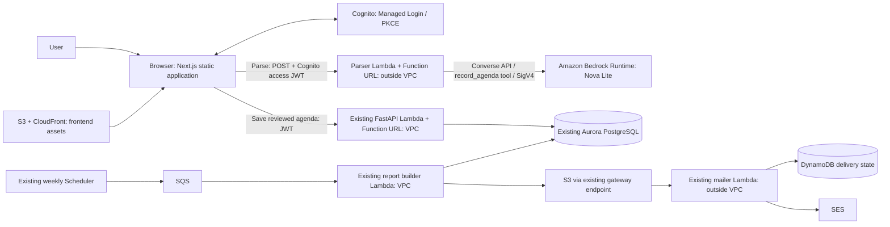

# Peach C4 level 2 — containers

The original Lab 1 C4 source was not present in this repository. This diagram
extends the documented deployed design. Backend and agenda migration0005 are
deployed. The frontend is published and agenda-v3 is deployed and enabled.
Five v2 UI tests and successful ordinary v3 parses were observed; v2 actual JSON
is missing. The October 21 recording is user-reported and not independently inspected.

The parser has no connection to Aurora or the existing API. The browser holds the
proposal for review; only an explicit Save calls the existing API. Parsed names
are text labels, never Cognito subjects or authorization grants. No NAT or paid
VPC interface endpoint is introduced. Migration runner remains private.
