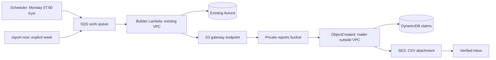

# Phase 3 reporting — architecture and deployment guide

> **Since 2026-10-31 these resources are managed by HCP Terraform**
> (`infra/reports.tf`, `infra/reports-iam.tf`; ADR 0007). The `peach-reports`
> stack was deleted after Retain was deployed. The CloudFormation deployment
> steps below are a historical record of Phase 3. Don't run them. Change
> reporting infrastructure through a PR and an HCP plan/apply.

Current deployment status (2026-10-11, Europe/Kyiv): `peach-reports` is
CREATE_COMPLETE. The manual W40 CSV and email are verified. The existing weekly
schedule was explicitly enabled for October 12 at 07:00 Kyiv; the real scheduled
W41 execution is still pending. The template remains DISABLED by default.
No claim is made that the full lab evidence is complete.

No AWS resources were created, changed, invoked or inspected through AWS APIs for
this phase. All examples below that call AWS are **future, MUTATING operations**
and require separate explicit authorization. Do not run them during local review.

## Architecture and resources



`infra/reports.yaml` is a separate stack. It does not declare any RDS resource,
NAT gateway, new security group, authentication resource or public function URL.
It does not run migrations. It consumes the existing VPC, subnets, backend
function security groups, database URL and immutable backend ECR image digest.
The image must actually contain the Phase 3 handlers and locked boto3 dependency;
an older digest with only the API cannot serve these handlers.

| Logical resource | Settings / responsibility |
| --- | --- |
| WorkQueue | Standard SQS; managed SSE; retention 4 days; visibility 720 seconds |
| BuilderDlq | Managed SSE; retention 14 days; only work queue allowed to redrive here |
| BuilderMapping | Batch 1; no batching delay; maximum concurrency 2 |
| Builder | Container command `app.reporting.builder.handler`; 120 seconds; 512 MB; unreserved concurrency; existing VPC/SGs |
| SchedulerDlq | Separate delivery-failure queue; managed SSE; 14 days |
| ScheduleGroup, WeeklySchedule | Monday `cron(0 7 ? * MON *)`, Europe/Kyiv, flexible window OFF, initially **DISABLED**; delivery age 24 hours, up to 3 delivery retries |
| ReportsBucket | Bucket owner enforced; all public access blocked; AES256 SSE; `reports/` expires after 90 days; retained on stack deletion/replacement |
| ReportsBucketPolicy | Denies non-HTTPS access; no source-VPC restriction that would block the mailer |
| S3Endpoint | Gateway endpoint; supplied existing subnet route tables; non-restricting shared-route policy; IAM/bucket policies authorize S3 access |
| Mailer | Container command `app.reporting.mailer.handler`; outside VPC; 60 seconds; 256 MB; unreserved concurrency |
| MailerS3Permission | Only the expected bucket/account may invoke; bucket creation waits for permission |
| MailerAsyncConfig | Two retries, maximum event age 6 hours; failure envelope to MailerFailureQueue |
| MailerFailureQueue | Managed SSE; 14 days; for asynchronous failures, not an automatic event-source consumer |
| MailState | DynamoDB on-demand, encrypted; conditional leases and durable SENT markers; retained, no TTL |
| BuilderRole, MailerRole, SchedulerRole | Separate scoped roles; no administrator policy |
| BuilderLogGroup, MailerLogGroup | Seven-day retention, project tags |

The bucket name is `${ProjectName}-reports-${AccountId}-${Region}`. All resources
use Peach names/tags. Bucket notification filters match `reports/` and `.csv`;
the handler additionally requires the **configured** scope and a valid ISO week.
Role policies and function bucket environments construct the name from parameters
instead of referring to the bucket resource, avoiding notification/permission/IAM
creation cycles. The offline tests check the dependency graph.

## Trusted configuration and reuse

Required private deployment parameters: `ReportOwnerSub`, `ReportScopeId`,
`ReportRecipientEmail`, `ReportFromEmail`, `ReportTimezone=Europe/Kyiv`,
`DatabaseUrl`, `VpcId`, `SubnetIds`, `RouteTableIds`,
`BackendFunctionSecurityGroupIds`, `ImageUri`, `Architecture`, `ProjectName`.
`AllowDirectEvents` defaults to `false` and offline preparation requires it false.
These map to `REPORT_OWNER_SUB`, `REPORT_SCOPE_ID`, `REPORT_RECIPIENT_EMAIL`,
`REPORT_FROM_EMAIL`, `REPORT_TIMEZONE` and the adapters' bucket/queue/table settings.
Only the builder receives the subject and database URL; the mailer receives neither.
Sensitive parameters have NoEcho; never commit values or print Lambda environments.
NoEcho does not hide values from authorized administrators reading Lambda settings.

Confirm the selected Cognito subject belongs to the intended authenticated test
account and that the intended recipient consents to receiving that account's
private meeting/task statistics. Keep a private review record. Use an opaque scope,
not an email or raw subject. **Changing the owner requires a new scope**, otherwise
old objects and SENT markers refer to the previous account. Confirm sender and
recipient SES identities in the deployment region. In the SES sandbox both must
be verified; a verified domain can cover the sender. Check regional sending quota
and sandbox status. Template deployment does not create or verify SES identities.

The builder calls the existing `WeeklyReportBuilder` with trusted `ReportConfig`,
a NullPool read-only repeatable-read SQLAlchemy session and the resolved week.
The Phase 2 week parser, owner-filtered queries, calculations and CSV renderer are
reused. An optional object-key metadata argument records the actual scoped S3
path; its default preserves local output. No AWS dependency was added to rendering. Optional task metrics
remain created-at counts plus a labelled current-status snapshot; no history or
completion date is invented. `make report-local` retains its existing interface
and disposable database verification.

## Events and validation

Manual messages contain **only**:

```json
{"source":"manual","week":"2026-W40","correlation_id":"unique-safe-identifier"}
```

Scheduled messages contain source `schedule`, `scheduled_time`, `correlation_id`,
`schedule_arn`, and `attempt`, substituted with Scheduler context attributes. The
builder converts **scheduled execution time**, not processing time, to Kyiv and
selects the previous completed ISO week. Retry delays or year/DST boundaries do
not change that selection. See [Scheduler context attributes](https://docs.aws.amazon.com/scheduler/latest/UserGuide/managing-schedule-context-attributes.html).

SQS records must come from the configured queue, contain exactly one record, and
have a valid bounded JSON body without duplicate fields. Unknown fields/sources,
invalid weeks, owner/recipient/bucket/SQL overrides and unsafe correlation strings
are rejected. No payload can change trusted deployment configuration. Failures
raise; Lambda's SQS integration retries and eventually redrives, rather than
acknowledging an unsuccessful report.

For the intermediate Scheduler-to-Lambda lab demonstration, use a separately
approved **isolated lab deployment** with `AllowDirectEvents=true`, a temporary
Scheduler target pointing at the builder, and a narrow InvokeFunction role. The
direct payload is the same strict `schedule` object above. This repository does
not create that temporary schedule or grant Scheduler InvokeFunction permission
in the production role. Demonstrate it using mocked tests first. Record a genuine
direct trigger only after separate authorization; revert the lab target and
configuration to SQS/false afterwards. The normal stack remains SQS-first.

## Idempotency, mail leases and recovery

Object keys are `reports/<opaque-scope>/YYYY-Www.csv`. The builder uses atomic
`IfNoneMatch="*"` PutObject; 412 is a successful duplicate, while 409/concurrent
conflicts and other errors propagate for retry. The first existing publication
is not overwritten, even if meetings later change. S3 lifecycle removes objects
after 90 days: object-level idempotency lasts while the object exists. SENT mail
markers persist beyond expiry, so regenerating an expired week does not resend
its email automatically. See [S3 conditional writes](https://docs.aws.amazon.com/AmazonS3/latest/userguide/conditional-writes.html).

Each S3 event key is decoded once, then checked against the expected bucket,
scope and valid week. A SHA256 of bucket/key identifies the DynamoDB claim.
Conditional updates acquire a 180-second lease; consistent reads distinguish an
already SENT report from an active lease. Active leases raise for retry, expired
leases are reclaimable, and claim tokens prevent stale workers releasing or
finishing newer claims. SENT markers suppress ordinary duplicate notifications.
No report titles, CSV contents, subjects or email addresses are logged.

Read/validation failures and definitive SES API failures release the claim for
retry. An ambiguous SES network failure or a failure recording success retains
the lease until expiry. **Exactly-once email cannot be guaranteed**: SES may have
accepted the send before the function failed to record SENT, so recovery can send
a duplicate. Retaining the lease delays such recovery; it does not eliminate the
boundary. Operators should inspect SES outcomes before replaying ambiguous sends.
The attachment is UTF-8 CSV with proper MIME/base64 encoding, capped at 5 MiB
before encoding to stay below [SES v1 raw-message limits](https://docs.aws.amazon.com/ses/latest/APIReference/API_SendRawEmail.html). Oversized/invalid files
fail to the asynchronous failure destination rather than sending partial data.

For a mailer failure, inspect the CloudWatch result and the failure queue's Lambda
**invocation envelope**. Fix the underlying SES/configuration/data issue, then,
after authorization and lease expiry, replay its `requestPayload` to the mailer.
Do not pass the envelope itself or blindly redrive this queue to the builder. A
SENT claim returns duplicate without sending again. Keep failure messages until
recovery is confirmed; dequeue/delete is an explicitly authorized mutation.

For builder DLQ recovery, inspect the body and error, correct the cause, then use
an authorized SQS redrive to the original work queue. If the payload itself is
invalid, remove it after retaining evidence and enqueue a corrected request;
redriving an unchanged invalid payload simply fails again. Scheduler DLQ entries
are delivery failures; repair delivery/IAM, then enqueue their valid scheduled
payload to the work queue, retaining the original scheduled timestamp.

## Local validation and preparation

```bash
# Offline validation; install cfn-lint locally if needed
make reports-validate
# Existing disposable database workflow, unchanged
make report-local WEEK=2026-W40
# Offline only: private CloudFormation parameter JSON, never committed
make reports-prepare PARAMETERS_FILE=.env.reports-parameters.local
```

The parameter file is a JSON array of `{"ParameterKey":"Name",
"ParameterValue":"value"}` entries using the required names above. Values must
come from deliberately reviewed existing infrastructure. Preparation performs no
AWS calls, does not build/push an image, and writes private mode-0600 ignored
`reports-local/deployment/parameters.json` and `review.json`. The review contains
the template hash, disabled schedule state and outstanding verification items.
Do not place secrets in shell arguments, repository examples or screenshots.

Backend tests use only mocks and the existing isolated `_test` database.
Infrastructure tests in `scripts/tests/test_reports_infra.py` use PyYAML from the
local cfn-lint environment; command tests intercept every subprocess call. Run
`pytest scripts/tests` in that validation environment. No AWS validation API is
needed. No backend static type checker is currently configured.

## Deployment checklist — NOT EXECUTED

1. Obtain separate explicit authorization for the target account/region, database
   reads, image push, reporting stack deployment and later schedule activation.
   Confirm this is the intended lab account, not an accidental production target.
2. Confirm the database already has additive revision **0004** and expected owner
   data. Reporting never runs migrations. If production is still on an older
   revision, use a separately authorized migration/release with existing snapshot,
   ownership and row-preservation safeguards before reporting deployment.
3. Build a reviewed Phase 3 backend Lambda image for the actual architecture,
   then, only with authorization, push it and record the immutable ECR digest.
   Reuse that digest for both report functions; do not update the API function as
   a side effect. Existing API deployment remains automatic on every main push after validation,
   with exact migration approval and snapshot preparation only for schema releases.
   Manual dispatch is also available; neither path deploys the reporting stack.
4. Review private owner/scope/inbox/sender values and regional SES verification.
   Verify VPC/subnet ownership, **each subnet's actual route table** (including
   main-table associations), and reuse of the backend function SG allowed into
   the existing DB SG. Verify SG egress/NACLs permit database and S3 HTTPS traffic.
5. Check for an existing S3 gateway endpoint and routes. Creating another endpoint
   on the same route tables can conflict; stop and review reuse/endpoint policy
   compatibility rather than replacing existing networking. The full-access endpoint
   policy preserves existing IAM/bucket authorization on the shared main route
   (all six subnets implicitly associated; no endpoints, owner-confirmed). Review
   source-IP policy conditions and reconnect/retry behavior because routing changes
   request source context and can disconnect existing S3 TCP connections.
6. Review deployer permissions and account concurrency. Both reporting Lambdas use
   unreserved concurrency; the SQS mapping limits builder concurrency to two.
   They share account capacity with other unreserved functions and may be throttled. Existing CI permissions do **not** cover all reporting
   services. Prefer a reviewed human/deployment role; do not expand the existing
   role automatically or grant AdministratorAccess.
7. Run all local checks, prepare private parameters, then create a **reporting-only**
   CloudFormation change set with `CAPABILITY_NAMED_IAM`. Example future mutation:

   ```bash
   aws cloudformation create-change-set --stack-name peach-reports \
     --change-set-name peach-reports-first-reviewed --change-set-type CREATE \
     --template-body file://infra/reports.yaml \
     --parameters file://reports-local/deployment/parameters.json \
     --capabilities CAPABILITY_NAMED_IAM
   ```

   This command creates a reviewable change set without executing it. For a new
   stack, the placeholder remains REVIEW_IN_PROGRESS until separately authorized
   execution. The role's policy does allow ExecuteChangeSet; approval is a
   procedural gate, not an IAM-enforced restriction. Do not use the automatic
   backend deployment script for this reporting operation.

   Use UPDATE only for an existing reporting stack. Inspect the complete change
   set and reject any unexpected operation or networking conflict. It must not
   replace/modify existing Aurora resources, API/auth stacks or database contents.
   Obtain approval for the concrete change set before executing it. This repository
   deliberately has **no automatic reporting deploy or activation target**.
8. After authorized execution, confirm actual image digests/handler commands,
   private bucket settings, route associations, role permissions, queue settings,
   event source mapping, failure destination and **DISABLED schedule**. Confirm
   connectivity with a deliberate SQS request and correct owner-scoped contents.
9. Verify a test email reaches the verified inbox and ordinary duplicate requests
   are suppressed. Only then obtain separate activation authorization and enable
   the schedule using a reviewed Scheduler update/console action preserving the
   exact cron, timezone, target, role, input, retry and DLQ configuration. Activation
   creates intentional drift from the disabled-by-default template; subsequent
   stack updates should be reviewed and may reset it to disabled. Do not silently
   change the default template to enabled.

### Permissions not granted by this implementation

The existing GitHub role lacks SQS queue management/tagging/redrive, Scheduler
schedule/group management, reports S3 bucket/notification/policy/encryption/lifecycle
management, DynamoDB table management and EC2 VPC endpoint creation/deletion/policy
modification permissions. These must be individually reviewed for a future deployer,
with project queue/table/bucket/schedule ARNs and VPC/route-table conditions where
supported. ENI-related runtime EC2 actions require wildcard resource scope where
AWS lacks usable resource restrictions. CloudFormation also needs the existing
IAM role creation/PassRole, log and Lambda permissions for the new named resources.
ECR image push/pull and resource policies must permit the account's Lambdas.
`report-now` needs only DescribeStacks for this stack (unless URL configured) and
SendMessage for its work queue. Activation/recovery operators need separately
scoped Scheduler update, SQS redrive or mailer invoke permissions. No permissions
or production IAM resources are changed in Phase 3.

## Lab evidence and future authorized commands

`make report-now WEEK=2026-W40` is **MUTATING**: it reads `WorkQueueUrl` from the
`peach-reports` stack and sends the strict manual message to that queue. It never
invokes the builder directly. It respects the existing AWS CLI profile/region;
`REPORT_QUEUE_URL` may instead supply the expected HTTPS project work-queue URL.
It accepts no owner, inbox or bucket arguments. Do not execute it during this phase.

For two objects, use **distinct week keys**: allow the scheduled execution to
publish its previous week (for example Monday 2026-10-12 → `2026-W41`), then request
`2026-W40` manually. If the scheduled week is W40, choose a different valid manual
week. Empty weeks still produce reports. Repeating the same week creates a
duplicate result, not a second object/email. Capture:

- Disabled schedule settings before activation, then approved cron/timezone/target
  and a real scheduled execution's context/correlation in builder logs.
- SQS request message ID plus builder log `trigger=manual`, week and result.
- Two distinct private S3 object keys with encryption/size metadata (avoid report
  contents or private owner/email details in shared screenshots).
- Mailer log `trigger=s3`, correlation/sequencer and SES message ID; a received
  email screenshot showing the CSV attachment, redacted where necessary.

Read-only future commands for evidence include `aws s3api list-objects-v2 --bucket
<reports-bucket> --prefix reports/<scope>/`, and `aws logs tail
/aws/lambda/peach-report-builder --since 1h` (similarly `peach-report-mailer`).
Treat downloaded CSVs/screenshots as private data.

To demonstrate builder DLQ handling without touching data, after specific approval
send one deliberately invalid week payload (`2025-W53`) to the work queue with
`source=manual` and a unique correlation ID. Parsing fails **before any DB query
or S3 write**. Observe receive counts 1, 2, 3 and the DLQ move. With 720-second
visibility and Lambda backoff this takes many minutes (roughly 24–36 or longer),
not an immediate three-call loop. Do not shorten production visibility, revoke
shared SG/IAM access, break Aurora, or insert fake production data. Keep evidence,
then delete that invalid message with authorization; do not redrive it unchanged.
Use an isolated lab stack for repeated failure demonstrations.

To stop safely: disable the schedule first with authorization. Disable the
builder event source mapping to stop consuming work; allow running invocations to
finish. Account for already queued messages/S3 async retries. Setting mailer
reserved concurrency to zero can cause S3 asynchronous events to go directly to
failure handling and must be deliberate; retain those events for later recovery.
Do not delete queues with pending evidence/work. Bucket and SENT table are retained
on stack deletion; review ongoing retention costs and ownership before any cleanup.
Do not remove the shared database, SGs, subnets or route tables.

## Costs, risks and discussion outline

- At-least-once delivery: SQS/S3/Lambda retries can deliver identical events more
  than once; successful acknowledgements and idempotency are separate concerns.
- Publication idempotency: a deterministic scope/week key plus atomic conditional
  write handles racing builders. A failed acknowledgement after upload retries
  as a duplicate. Expiration limits S3's existence-based guarantee.
- Email suppression: durable conditional claims, leases and SENT markers prevent
  ordinary duplicates and recover crashed workers; SES and DynamoDB do not share
  an atomic transaction, so ambiguous sends can duplicate during recovery.
- Networking: NAT incurs standing/per-GB costs. An S3 **gateway** endpoint has no
  endpoint hourly charge; route/policy review is essential. Splitting the mailer
  outside the VPC avoids paid interfaces/NAT for SES/DynamoDB. SQS polling is done
  by Lambda's service, so the VPC builder itself makes no SQS API calls.
- Presigned URLs are not used; reports are attachments. A future presigned URL is
  a bearer capability, expires at its configured time or earlier when signing
  credentials expire/revoke, and does not make the private bucket public. See
  [presigned URL expiration](https://docs.aws.amazon.com/AmazonS3/latest/userguide/using-presigned-url.html). Short
  expirations and private sharing still matter.
- Costs remain usage-based Lambda, SQS, Scheduler, S3 requests/storage, DynamoDB,
  SES and CloudWatch; Aurora resumes consume ACUs. NullPool avoids idle database
  connections blocking auto-pause. No always-on worker or NAT is introduced.
- Private reports and inboxes need explicit owner confirmation. Review IAM scopes,
  endpoint impact on shared route tables, environment-secret visibility, retained
  bucket/table costs and async failure recovery before authorized deployment.

## Application CI/CD boundary

Backend pushes remain automatic. Their workflow validates reporting templates and
handler imports but does not deploy or activate this stack. Frontend remains manual.
See [deployment policy](deployment.md) for ordinary/schema releases, revision `0004`
preparation, rollback and the proposed separate reporting image-update workflow.
Use the immutable digest of an explicitly reviewed Phase 3 release, not the newest
ECR image or a legacy-cleanup image. The first CREATE change set and execution remain
separately controlled; no reporting update automation is introduced here.

## First-deployment IAM review

The local-only [IAM policy bundle and Console guide](../infra/iam/reports/README.md)
separate human deployment, CloudFormation execution, runtime and test/recovery access.
No reporting permissions are added to the automatic backend GitHub role. Actual
inbox/scope values and rendered JSON remain in ignored private files. Resolve the
shared-route source-context and reconnect review before any authorized change-set execution.
